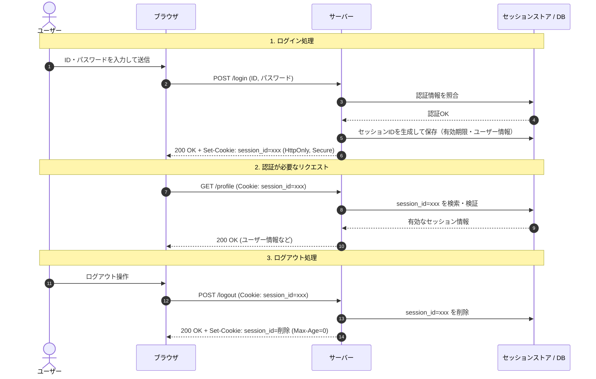
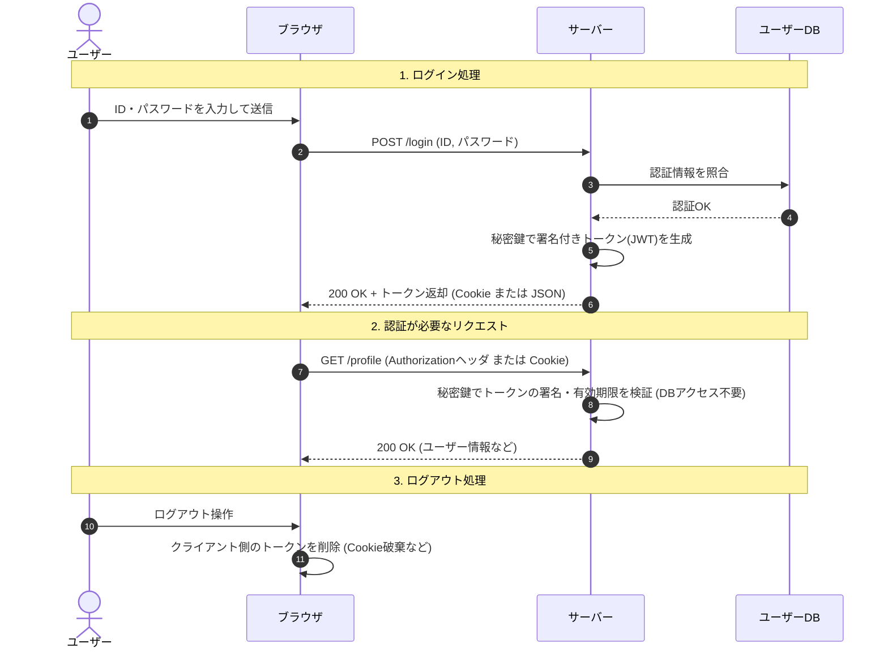

# Session認証

Webアプリケーションにおいて、ユーザーのログイン状態をサーバー側で管理し、ページ遷移や追加リクエストのたびに再ログイン不要で本人確認を行う認証方式。ログイン成功時にサーバーがセッションIDを発行してブラウザのCookieに保存し、以降のリクエストでそのIDを照合してユーザーを識別する。

## Cookie

サーバーがブラウザに保存させる key-value 形式のデータ。ブラウザは保存したCookieを、条件に合うリクエストに自動で付与して送信する。HTTPはステートレスなプロトコルのため、リクエスト間で状態を引き継ぐ手段として使われる。

- サイズの上限は1個あたり約4KB（name・value・属性の合計）
- 1ドメインあたりの保存数にもブラウザごとの上限がある(Chrome, Edge: 約180個, Safari: 約600個, FireFox: 約150個)

### セッション認証での役割

- Cookieに保存するのはセッションIDのみ。ID・パスワードなどの認証情報そのものは保存しない
- ユーザー情報の本体はサーバー側（セッションストア／DB）で管理する

### Cookieに関するHTTPヘッダ

| ヘッダ | 方向 | 役割 |
|---|---|---|
| `Set-Cookie` | レスポンス（サーバー → ブラウザ） | Cookieの保存・更新・削除を指示する |
| `Cookie` | リクエスト（ブラウザ → サーバー） | 保存しているCookieを送信する |
| `Clear-Site-Data` | レスポンス（サーバー → ブラウザ） | そのオリジンのCookieなどをまとめて削除させる |

origin: 「通信方式＋ホスト名＋ポート番号」の組み合わせ
### レスポンスヘッダ：`Set-Cookie`

`name=value` の後に、`;` 区切りで属性を並べる。

```http
HTTP/1.1 200 OK
Set-Cookie: session_id=a3f9c2e1; Path=/; Max-Age=3600; HttpOnly; Secure; SameSite=Lax
Set-Cookie: theme=dark; Path=/; Max-Age=31536000
```

- Cookie1つにつき `Set-Cookie` を1行使う。複数ある場合は複数行に分ける
- 属性はブラウザがCookieを保存・送信する際の条件で、サーバーには送り返されない

#### 属性

| 属性 | 例 | 意味 | 省略時 |
|---|---|---|---|
| `Expires` | `Expires=Wed, 01 Dec 2026 00:00:00 GMT` | 有効期限を日時（GMT）で指定 | セッションCookie（ブラウザ終了時に削除） |
| `Max-Age` | `Max-Age=3600` | 有効期限を秒数で指定。`Expires` より優先される。`0` 以下で即削除 | 同上 |
| `Domain` | `Domain=example.com` | 送信先のドメイン。指定するとサブドメインにも送信される | 発行元ホストのみ（サブドメインには送信されない） |
| `Path` | `Path=/` | 送信先のパス。指定パス以下のリクエストにのみ送信される | 発行元URLのディレクトリ以下 |
| `Secure` | `Secure` | HTTPS通信時のみ送信する | HTTPでも送信される |
| `HttpOnly` | `HttpOnly` | JavaScript（`document.cookie`）からのアクセスを禁止する。XSS対策 | JavaScriptからアクセス可能 |
| `SameSite` | `SameSite=Lax` | クロスサイトリクエストでの送信可否。CSRF対策 | 主要ブラウザでは `Lax` 扱い |
| `Partitioned` | `Partitioned` | トップレベルサイトごとに分離して保存する（CHIPS）。埋め込み先ごとに別のCookieになる。`Secure` 必須 | 分離しない |
| `Priority` | `Priority=High` | 上限超過で削除する際の優先度（`Low` / `Medium` / `High`）。Chrome独自の拡張 | `Medium` |

#### `SameSite` の値

| 値 | クロスサイトリクエストでの挙動 | 用途 |
|---|---|---|
| `Strict` | 送信しない（外部サイトのリンクからの遷移時も送信しない） | 安全性を最優先する場合 |
| `Lax` | トップレベルのGETナビゲーション（リンクでの遷移）のみ送信。POSTやiframe・画像などのサブリソースでは送信しない | 一般的なセッションCookie |
| `None` | 常に送信する。`Secure` が必須 | 他サイトに埋め込まれるサービス（外部ログイン、ウィジェットなど） |

### リクエストヘッダ：`Cookie`

ブラウザは、送信先のドメイン・パス・`Secure`・`SameSite`・有効期限の条件に合うCookieを選んで送信する。

```http
GET /profile HTTP/1.1
Host: example.com
Cookie: session_id=a3f9c2e1; theme=dark
```

- 書式は `name=value` を `; ` で連結したもの。複数のCookieを1行にまとめて送る
- 送信されるのは name と value のみ。属性は含まれないため、サーバーはこのヘッダから有効期限などを知ることはできない
- セッション認証では、サーバーはここから `session_id` を取り出してセッションストアで照合する

### Cookieの更新・削除

Cookieは name・`Domain`・`Path` の組み合わせで識別される。この3つが一致する `Set-Cookie` を送ると、既存のCookieが上書きされる。

#### 更新（上書き）

同じ name・`Domain`・`Path` で新しい値や属性を送る。

```http
Set-Cookie: theme=light; Path=/; Max-Age=31536000
```

- `Domain` や `Path` が異なると別のCookieとして追加され、同名のCookieが並存する
- セッション固定攻撃の対策として、ログイン成功時にはセッションIDを新しい値に発行し直す

#### 削除

同じ name・`Domain`・`Path` で、有効期限を過去にした `Set-Cookie` を送る。

```http
Set-Cookie: session_id=; Path=/; Max-Age=0
Set-Cookie: session_id=; Path=/; Expires=Thu, 01 Jan 1970 00:00:00 GMT
```

- 削除専用のヘッダや属性はなく、期限切れにすることで削除する
- `Domain`・`Path` が保存時と一致しないと削除されない

オリジンのCookieをまとめて削除する場合は `Clear-Site-Data` を使う（ログアウト時など）。

```http
Clear-Site-Data: "cookies"
```

#### クライアント側からの操作

- JavaScriptの `document.cookie` で読み書き・削除ができる（削除は `Max-Age=0` を設定する）
- `HttpOnly` が付いたCookieはJavaScriptからは操作できず、サーバーからの `Set-Cookie` でのみ変更・削除できる
- ユーザーはブラウザの設定や開発者ツールから手動で削除できる

### 名前の由来

プログラム間でやり取りするデータ片を指す用語「マジッククッキー」に由来するとされる。

## DB型



セッション情報をサーバー側のDBに保存し、ブラウザにはセッションIDをCookieで渡す方式である。リクエストごとに、そのIDを使ってDB内のセッションの有効性を確認する。ログアウト時はDBからセッションを削除することで、即座に無効化できる。


## ステートレス型


ユーザーIDや有効期限などを含む署名付きトークンを、ブラウザに保持させる方式である。サーバーは署名と有効期限を検証するため、セッション照合のためのDBアクセスは不要になる。ただし、ログアウトでブラウザから削除しても、トークン自体を有効期限前に失効させるには別の仕組みが必要である。


